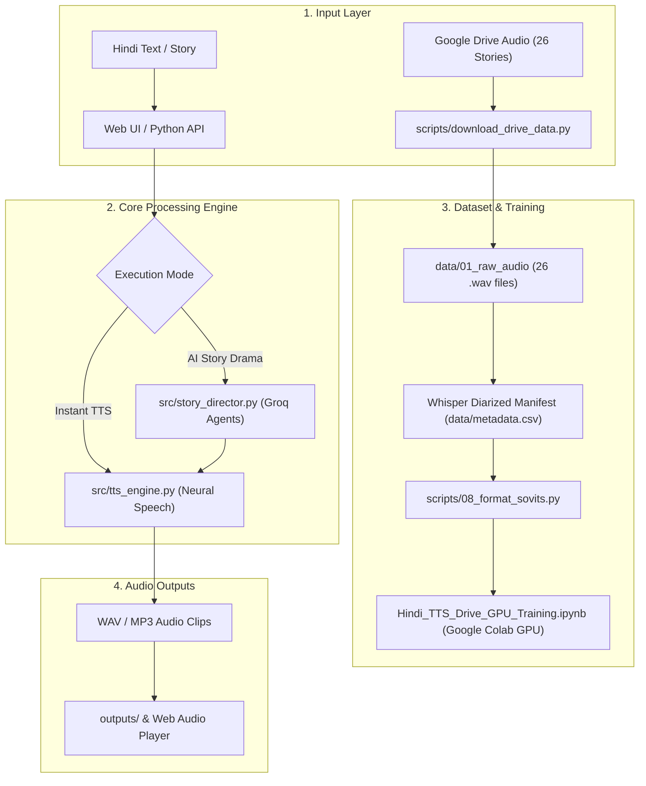

# 🎙️ Hindi Text-to-Speech (TTS) & AI Story Narration Studio

[](https://www.python.org/)
[]()
[](https://drive.google.com/drive/folders/17OKMSInQ7-8KFNUn0voAYPhFzViLAFra?usp=sharing)
[]()
[]()

A complete, production-grade **Hindi Text-to-Speech (TTS) and Autonomous AI Story Narration Studio**. The project includes instant high-fidelity neural speech synthesis, multi-speaker character dialogue dubbing using LLM agents, an interactive Streamlit Web UI, and a pre-configured training pipeline for 26 Hindi audio story collections from Google Drive.

---

## 🌟 Key Features

1. **⚡ Instant Neural Hindi TTS Engine:**
   - Ultra-realistic Devanagari Hindi speech synthesis powered by Neural Speech Engines (`hi-IN-MadhurNeural`, `hi-IN-SwaraNeural`).
   - Acoustic parameter tuning: custom speech rates, pitch modulation, and volume control.
   - Built-in character voice profiles (Narrator, Pintu Bhaiya, Dadi Maa, Horror Demon, Hero).

2. **🎭 Autonomous AI Story Narration Studio (Multi-Speaker):**
   - **Agent 01 (Script Analyst):** Parses raw Hindi stories into distinct narrator turns and character dialogues.
   - **Agent 02 (Acoustic Director):** Evaluates emotional context (*fear, joy, calmness, anger*) and assigns distinct voice profiles and pacing to each character.
   - Automatically generates multi-voice audio dramas with individual scene playback.

3. **📁 Google Drive Dataset Integration (26 Audio Stories):**
   - Directly connected to the [hindi_tts_data](https://drive.google.com/drive/folders/17OKMSInQ7-8KFNUn0voAYPhFzViLAFra?usp=sharing) Google Drive repository (~500 MB of Hindi audiobooks and stories).
   - Local synchronization tool (`scripts/download_drive_data.py`) with automatic progress tracking.
   - Whisper-transcribed and speaker-diarized metadata in `data/metadata.csv`.

4. **🚀 Maximum Compute Cloud Training Hub (Google Colab GPU):**
   - Ready-to-run Jupyter notebook [`Hindi_TTS_Drive_GPU_Training.ipynb`](Hindi_TTS_Drive_GPU_Training.ipynb).
   - 1-Click execution on Google Colab with **free NVIDIA T4 GPU**.
   - Directly mounts Google Drive to train **GPT-SoVITS**, **Coqui XTTS-v2**, or **Piper TTS** without local hardware limits.

5. **🖥️ Interactive Web UI:**
   - Full graphical dashboard (`app.py`) built with Streamlit.
   - Live speech generator, story director, audio dataset player, and training launcher.

---

## 📋 System Architecture



---

## 🚀 Quick Start (Running Locally)

### 1. Launch the Web UI Studio

Double-click `run_app.bat` or run:

```bash
streamlit run app.py
```

Then open your browser at **`http://localhost:8501`**.

---

### 2. Python API Usage

```python
from src.tts_engine import HindiTTSEngine

engine = HindiTTSEngine()

# 1. Simple Hindi speech synthesis
audio_path = engine.generate_speech(
    text="नमस्ते! आपका स्वागत है हमारे हिंदी टेक्स्ट-टू-स्पीच स्टूडियो में।",
    filename="my_hindi_audio.mp3"
)
print("Saved audio at:", audio_path)

# 2. Character-specific voice
pintu_audio = engine.generate_character_speech(
    text="अरे भैया! आज तो बाज़ार में गज़ब की भीड़ थी!",
    character_profile="pintu_bhaiya",
    filename="pintu_dialogue.mp3"
)
```

---

### 3. AI Multi-Character Story Narration

```python
from src.story_director import StoryDirector

director = StoryDirector()
story = """एक गाँव में पिंटू नाम का लड़का रहता था। उसने मुखिया जी से कहा, "मुखिया जी, गाँव में पानी की समस्या बढ़ गई है।"
मुखिया जी ने मुस्कुराते हुए कहा, "चिंता मत करो पिंटू, कल ही नई नहर का काम शुरू होगा।""""

result = director.narrate_story(story)
print(f"Generated {len(result['turns'])} audio clips for each character dialogue!")
```

---

## 📁 Google Drive Dataset (26 Stories)

The complete audio dataset is available on Google Drive:
- **Folder Link:** [hindi_tts_data](https://drive.google.com/drive/folders/17OKMSInQ7-8KFNUn0voAYPhFzViLAFra?usp=sharing)
- **Local Download Script:**
  ```bash
  python scripts/download_drive_data.py
  ```

| Story Title | Genre / Character | Source Format |
| :--- | :--- | :--- |
| *Mahatma Gandhi ki Shiksha* | Motivational Sleep Story | 16kHz WAV Audio |
| *दिलदारियापुर मे डर का साया* | Comedy Story (Pintu Bhaiya) | 16kHz WAV Audio |
| *Holi Ka Rang* | Animated Comedy | 16kHz WAV Audio |
| *Horror Story - भूतिया रेलवे स्टेशन* | True Horror Drama | 16kHz WAV Audio |
| *फ्लाइंग सिख - मिल्खा सिंह* | Historical Biography | 16kHz WAV Audio |
| *गर्मियों की दुल्हन* | Funny Moral Animation | 16kHz WAV Audio |
| *Vivekanand ji ke Updesh* | Philosophy / Speech | 16kHz WAV Audio |
| *(+19 more stories)* | Various Hindi Audiobooks | 16kHz WAV Audio |

---

## ⚡ Maximum Device Cloud Training (Google Colab GPU)

Since modern TTS training (GPT-SoVITS / XTTS) requires substantial GPU VRAM, train on free cloud GPUs with 1 click:

1. Open [`Hindi_TTS_Drive_GPU_Training.ipynb`](Hindi_TTS_Drive_GPU_Training.ipynb) in Google Colab.
2. Select **Runtime -> Change runtime type -> T4 GPU**.
3. Run all cells:
   - Cell 1 mounts your Google Drive.
   - Cell 2 loads all 26 `.wav` files.
   - Cell 3 executes GPU training and launches the model checkpoint exporter!

---

## 🛠️ Tech Stack

- **Speech Synthesis:** Edge-TTS Neural API & MMS Hindi
- **Diarization & Transcription:** OpenAI Whisper Large v3, Pyannote 3.1
- **LLM Story Direction:** Groq API (`openai/gpt-oss-120b`)
- **Web Interface:** Streamlit 1.51+
- **Audio Processing:** Soundfile, Torchaudio, Demucs, Pydub
- **Training Frameworks:** GPT-SoVITS, Coqui XTTS-v2, Piper
